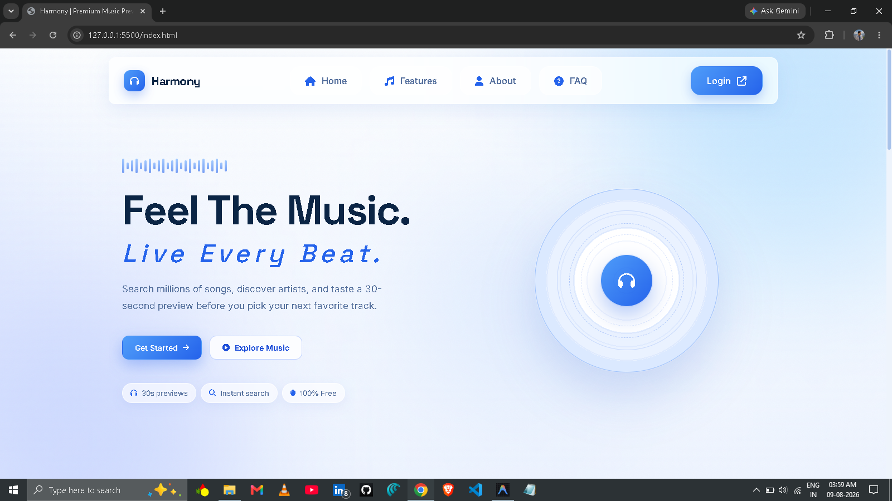
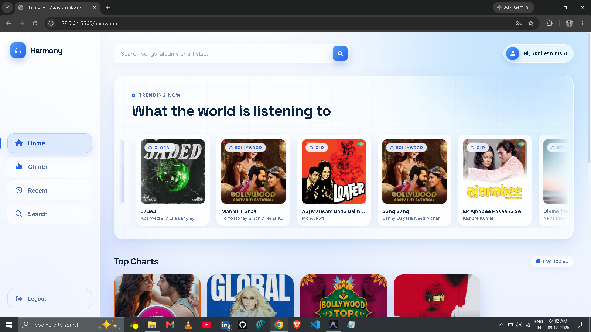
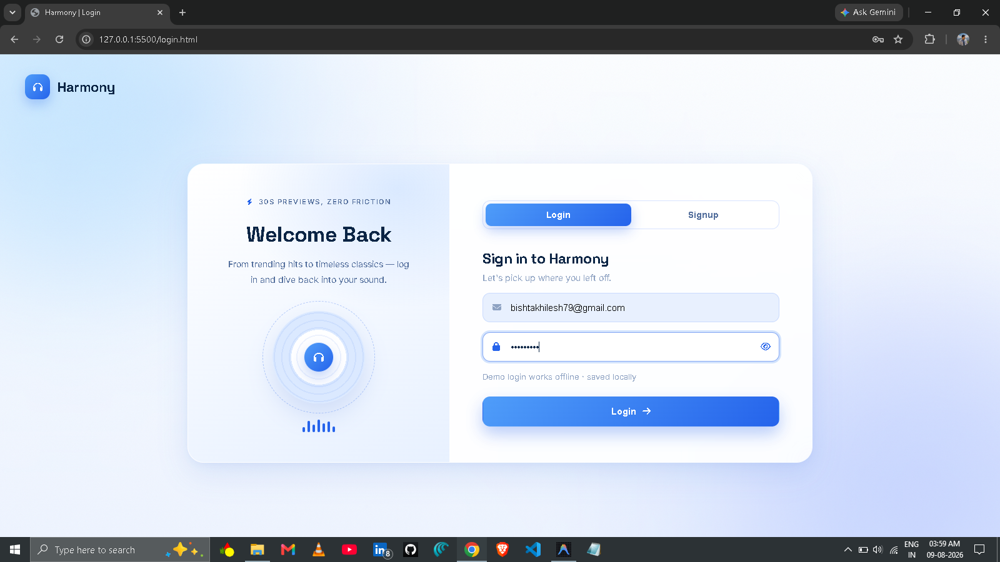
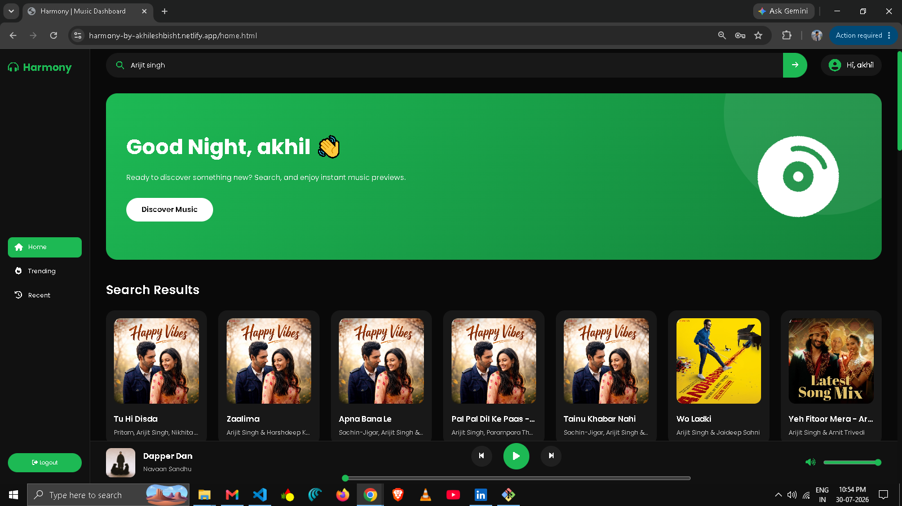
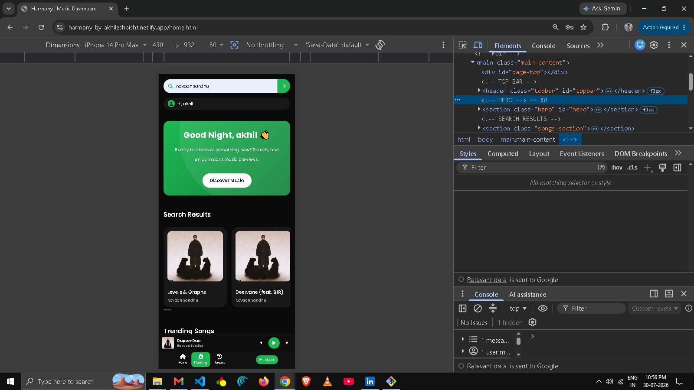

<div align="center">

# 🎵 Harmony

### A Modern Music Preview Web Application

Search songs, discover artists, and enjoy 30-second music previews powered by the iTunes Search API.

🌐 **Live Demo:** https://harmony-by-akhileshbisht.netlify.app/

</div>

---

# 📖 About

Harmony is a responsive frontend music preview web application developed using **HTML5**, **CSS3**, and **JavaScript**.

The application uses the **iTunes Search API** to fetch songs dynamically and allows users to listen to 30-second previews before exploring new music.

This project was built to improve my frontend development skills, API integration knowledge, and responsive web design practices.

---

# ✨ Features

- 🎵 Search songs instantly
- 🎧 30-second music previews
- 🔍 Artist search
- 📱 Fully Responsive Design
- 🔐 Local Storage Login System
- ⚡ Fast Search Results
- 🎨 Modern User Interface
- 🌍 Live Deployment on Netlify

---

# 🛠️ Tech Stack

| Technology | Usage |
|------------|-------|
| HTML5 | Page Structure |
| CSS3 | Styling |
| JavaScript (ES6) | Functionality |
| iTunes Search API | Music Data |
| Local Storage | Login Authentication |
| Netlify | Deployment |
| Git & GitHub | Version Control |

---

# 📂 Project Structure

```
Harmony
│
├── assets/
│   └── images/
│       └── screenshots/
│
├── css/
│   ├── home.css
│   ├── index.css
│   └── login.css
│
├── images/
│
├── home.html
├── home.js
├── index.html
├── index.js
├── login.html
├── login.js
│
└── README.md
```

---

# 🚀 Live Demo

### 🔗 Website

https://harmony-by-akhileshbisht.netlify.app/

---

# 📸 Screenshots

## 🏠 Landing Page



---

## 🎵 Home Page



---

## 🔐 Login Page



---

## 🔎 Search Page



---

## 📱 Responsive Design



> Screenshot Coming Soon

---

## Home Page

> Screenshot Coming Soon

---

## Login Page

> Screenshot Coming Soon

---

## Search

> Screenshot Coming Soon

---

# ⚙️ Installation

Clone the repository

```bash
git clone https://github.com/akhileshbisht79/Harmony.git
```

Move into the project

```bash
cd Harmony
```

Open the project using Visual Studio Code.

Run **index.html** using Live Server.

---

# 🎯 Future Improvements

- Playlist Support
- Favorites
- Better Search Suggestions
- Backend Integration
- User Database
- Full Music Streaming
- User Profiles

---

# 👨‍💻 Author

## Akhilesh Bisht

Frontend Developer

Currently Learning Backend Development & Full Stack Development

GitHub

https://github.com/akhileshbisht79

LinkedIn

(Add your LinkedIn profile here)

---

# ⭐ If you like this project

Please consider giving this repository a ⭐.

It motivates me to continue building more projects.

---

<div align="center">

Made with ❤️ using HTML, CSS & JavaScript

</div>